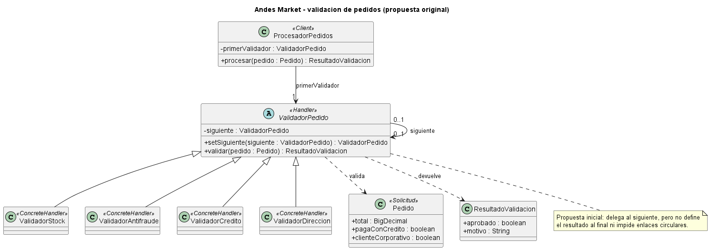
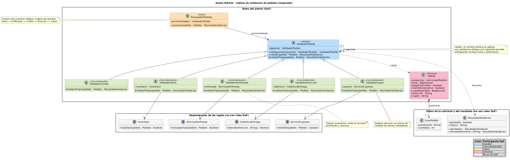
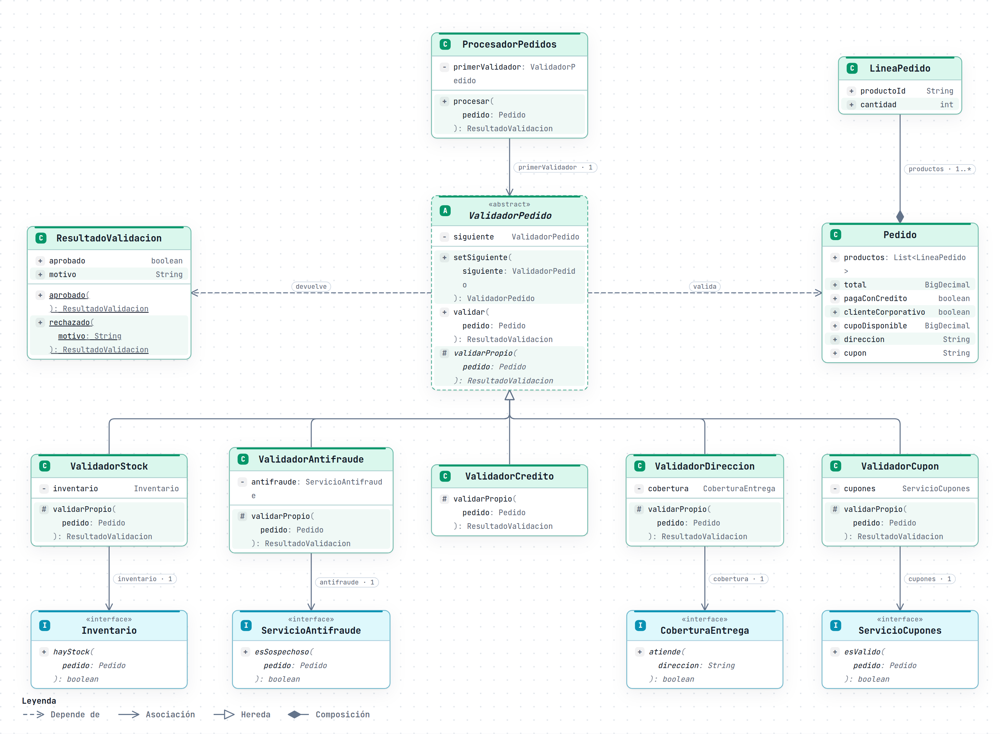

# Escenario 1: validación de pedidos de Andes Market (Chain of Responsibility)

## 1. Escenario / Motivación

*Andes Market* es una tienda en línea ficticia de tecnología y hogar que procesa cientos de pedidos al día.
Antes de confirmar un pedido y enviarlo a bodega, lo somete a cuatro validaciones, en este orden: **stock**,
**antifraude**, **límite de crédito** (solo si paga con el crédito de la tienda) y **dirección de envío** con
cobertura. Si una falla, el pedido se rechaza con el motivo y las siguientes ya no se ejecutan (si no hay stock
no tiene sentido consultar el servicio antifraude, que es externo y costoso). Si llega al final sin rechazos,
queda aprobado.

Las reglas cambian con frecuencia: en *Black Friday* se quiere agregar una validación de **cupones**, riesgos
pide que los **clientes corporativos** no pasen por antifraude y operaciones quiere **reordenar** las
validaciones para ejecutar primero las baratas. El texto completo está en
[`docs/enunciado-actividad-03.md`](../docs/enunciado-actividad-03.md).

## 2. Problema de diseño identificado

La solución directa es un método único con una secuencia de condicionales. Presenta cinco dificultades:

- **Acoplamiento:** quien procesa el pedido conoce el inventario, el antifraude, el crédito y la cobertura, y
  el orden en que se consultan.
- **Abierto/cerrado:** agregar cupones obliga a modificar un método que ya funciona.
- **Orden fijo:** reordenar implica mover bloques de código.
- **Responsabilidades mezcladas:** las excepciones de negocio (corporativos) se suman como condiciones.
- **Pruebas difíciles:** ninguna regla se prueba sola; cada caso debe superar las anteriores.

El problema de fondo es que el emisor de la solicitud (el pedido) queda acoplado a todos sus posibles
receptores y a la secuencia en que intervienen.

## 3. Justificación del patrón

Se eligió **Chain of Responsibility** (evitar acoplar el emisor de una solicitud con su receptor encadenando
varios objetos que pueden atenderla) en su variante de **cadena de filtros**: a diferencia de la forma clásica,
donde la cadena termina cuando *un* eslabón atiende la solicitud, aquí cualquier eslabón puede detenerla con un
rechazo y el resultado por defecto es la aprobación.

**Alternativas consideradas:**

- *Strategy*: elige un solo algoritmo; aquí se aplican varias reglas en secuencia.
- *Decorator*: añade comportamiento y siempre delega; aquí una regla puede detener el recorrido.
- *Bucle sobre una lista de validadores*: es más simple, pero el cliente volvería a conocer la secuencia
  completa y la decisión de continuar dejaría de estar en cada eslabón.

**Comportamiento definido de la cadena:** un rechazo la detiene y devuelve el motivo; una aprobación delega
en el siguiente; si no hay siguiente, el pedido queda aprobado. `setSiguiente` rechaza autoenlaces y ciclos.

## 4. Participantes del patrón

| Participante GoF | Elemento del dominio | Responsabilidad |
|---|---|---|
| Handler | `ValidadorPedido` | Guarda el `siguiente`, implementa `validar` (detiene o delega) y declara `validarPropio` para cada regla. |
| ConcreteHandler | `ValidadorStock`, `ValidadorAntifraude`, `ValidadorCredito`, `ValidadorDireccion`, `ValidadorCupon` | Cada uno encapsula una sola regla; cupones es un eslabón opcional. |
| Client | `ProcesadorPedidos` | Conoce solo el primer validador y le envía el pedido. La cadena la arma quien configura (en la demo, `Demo`). |
| Solicitud | `Pedido` | Aporta los datos que recorren la cadena. |
| Datos de la solicitud y del resultado (no son roles GoF) | `LineaPedido`, `ResultadoValidacion` | Las líneas del pedido, y la aprobación o el rechazo con motivo. |
| Dependencias de las reglas (no son roles GoF) | `Inventario`, `ServicioAntifraude`, `CoberturaEntrega`, `ServicioCupones` | Interfaces que permiten probar cada validador con dobles. |

**Colaboración:** `ProcesadorPedidos` llama a `validar(pedido)` del primer eslabón; este aplica su
`validarPropio`; si aprueba, llama a `validar` del siguiente, y si rechaza devuelve el motivo hacia atrás hasta
el procesador. La exclusión de clientes corporativos se decide dentro de `ValidadorAntifraude`.

## 5. Diagrama de clases UML

| Versión | Fuente PlantUML | Imagen |
|---|---|---|
| Original | [chainE1.puml](uml/chainE1.puml) | [Diagrama original](uml/diagrama-clases-original.png) |
| Mejorada (implementada) | [chainE1_mejorado.puml](uml/chainE1_mejorado.puml) | [Diagrama mejorado](uml/diagrama-clases-mejorado.png) |
| Secuencia | [chainE1_secuencia.puml](uml/chainE1_secuencia.puml) | Fuente editable; no se solicitó PNG |

**Cómo leer el diagrama mejorado.** Las clases están agrupadas como en la tabla de participantes: *Roles del
patrón (GoF)* (Client, Handler, ConcreteHandler y Solicitud, un color por rol según la leyenda), *Datos de la
solicitud y del resultado* y *Dependencias de las reglas*. Los dos últimos grupos no son roles GoF.

Vista del mismo diseño generada con archify, con los miembros de cada tipo. Existe también una versión
interactiva con vistas guiadas, [`uml/diagrama-clases-mejorado.html`](uml/diagrama-clases-mejorado.html); GitHub
no ejecuta HTML, así que hay que descargarla y abrirla en el navegador. El `.puml` sigue siendo el contrato.

La versión original identifica cuatro validadores, el pedido y el cliente, pero deja ambiguo qué ocurre al
terminar la cadena y no impide enlaces circulares. La mejorada define el resultado aprobado al llegar al final,
separa la regla de cada eslabón en `validarPropio`, prohíbe ciclos al enlazar e incorpora el validador opcional
de cupones. Inventario, antifraude, cobertura y cupones aparecen como dependencias mediante interfaces.

El [diagrama de secuencia](uml/chainE1_secuencia.puml) muestra un pedido corporativo que supera stock, omite la
consulta antifraude, supera crédito y dirección, y se rechaza por cupón inválido; el rechazo vuelve al
procesador con su motivo. El caso se ejecuta en la demo (pedido 8) y en `ProcesadorPedidosTest`.

## 6. Código fuente

- Repositorio: <https://github.com/ups-master/pds-actividad-03-grupo-01/tree/main/escenario-1-chain-of-responsibility>
- Manual de uso (estructura, pruebas, ejecución, cómo agregar un eslabón): [`codigo/README.md`](codigo/README.md)
- Trazabilidad UML-código: [`docs/trazabilidad-uml-codigo.md`](docs/trazabilidad-uml-codigo.md)
- Pruebas: 69 (42 de correspondencia UML-código y 27 funcionales), todas aprobadas.

## 7. Validación de la solución

**Qué problema resolvió.** El procesador ya no conoce las reglas ni su orden: cada validador aprueba y delega o
rechaza y detiene. Se agregaron cupones, se omitió antifraude para corporativos y se reordenó la cadena
(dirección y stock antes que antifraude) sin modificar `ProcesadorPedidos` ni los demás validadores.

**Qué mejoró frente a la solución directa.**

- Abierto/cerrado: `ValidadorCupon` es una clase nueva que se inserta al armar la cadena.
- Orden configurable: una prueba arma dirección → stock → antifraude y comprueba que el servicio costoso no se
  consulta si la dirección falla.
- Pruebas aisladas: cada validador se prueba con dobles de sus interfaces, sin preparar un pedido que supere
  las reglas anteriores.
- Rechazo con motivo y sin consultas innecesarias: la cadena se detiene en el primer fallo.

**Costos y complejidad adicional.**

- El flujo queda repartido en varias clases, lo que dificulta la depuración.
- Una cadena mal armada solo se detecta en ejecución. Por eso `setSiguiente` rechaza ciclos y se prueban las
  cadenas; aun así, olvidar enlazar un eslabón no produce error: el pedido simplemente se aprueba sin esa regla.
- Hay una clase por regla más cuatro interfaces de dependencia.
- La cadena se detiene en el primer rechazo: no informa todos los problemas del pedido a la vez.

**Cuándo no se recomienda.** Con pocas reglas estables y de orden fijo, un método con condicionales es más
claro. Tampoco cuando se necesita reunir todos los errores en una sola respuesta, o cuando debe elegirse un
único algoritmo según un criterio (ahí corresponde *Strategy*).

## 8. Uso crítico de IA

**Prompt principal:**

Actúa como un arquitecto de software experto en patrones de diseño GoF, UML y PlantUML. Adjunto el archivo PlantUML de mi solución inicial al Escenario 1 (validación de pedidos de Andes Market con Chain of Responsibility). El pedido pasa por stock, antifraude, crédito y dirección, y se rechaza en la primera validación que falle. El negocio quiere agregar una validación de cupones, que los clientes corporativos no pasen por antifraude y poder reordenar las validaciones sin modificar a quien procesa el pedido. Valida si el diagrama aplica correctamente el patrón y cumple esos requisitos:

1. Verifica que estén todos los roles del patrón (Handler, ConcreteHandler, Client y solicitud) y que cada clase cumpla su responsabilidad.
2. Revisa que el cliente conozca solo el primer eslabón y que cada eslabón conozca solo a su siguiente.
3. Comprueba que esté definido qué pasa cuando un eslabón aprueba, cuando rechaza y cuando la cadena termina, y si hay riesgo de enlaces inválidos.
4. Evalúa si el diseño permite agregar, quitar o reordenar eslabones sin modificar las clases existentes.
5. Revisa que relaciones, multiplicidades, visibilidades y dependencias sean correctas y suficientes para implementar el diseño.

Condiciones: no cambies el patrón ni los nombres de las clases existentes; justifica cada mejora con un problema concreto del diagrama; no generes código Java. Entrega una lista de problemas encontrados, las mejoras propuestas con su justificación, el archivo PlantUML completo con las mejoras aplicadas y, por separado, al menos una alternativa de diseño con sus ventajas y desventajas, sin aplicarla.

**Recomendación aceptada (con justificación):** se aceptó el conjunto de mejoras que la IA propuso sobre el diagrama inicial y que forman el diagrama mejorado (`chainE1_mejorado.puml`), del que se deriva el código:

1. Separar la regla de cada eslabón en `validarPropio` y dejar en `ValidadorPedido` la decisión de continuar o detenerse.
2. Definir el resultado al final de la cadena (sin siguiente, aprobado) e impedir autoenlaces y ciclos en `setSiguiente`.
3. Modelar los servicios externos como interfaces (`Inventario`, `ServicioAntifraude`, `CoberturaEntrega`, `ServicioCupones`) asociadas a su validador.
4. Incorporar `ValidadorCupon` como eslabón opcional.
5. Completar `Pedido` (productos, cupo, dirección, cupón), agregar `LineaPedido` en composición y las fábricas `aprobado()` y `rechazado(motivo)` de `ResultadoValidacion`.
6. Dejar la excepción de clientes corporativos dentro de `ValidadorAntifraude`.

La aceptamos porque el diseño inicial no definía qué ocurría al terminar la cadena y permitía enlaces circulares que causarían una recursión infinita. Con `validarPropio`, la delegación queda en un único lugar y cada validador implementa solo su regla. Las interfaces permiten probar cada validador por separado con dobles de prueba. Los cupones se agregan sin modificar las validaciones existentes, como pide el área comercial.

**Recomendación modificada o rechazada (con justificación):** que `ProcesadorPedidos` guarde una lista con todos los validadores y los recorra en un bucle, deteniéndose en el primer rechazo.

La rechazamos porque, aunque simplifica el armado, el cliente volvería a conocer la secuencia completa y la decisión de continuar dejaría de estar en cada eslabón, que es el acoplamiento que el patrón busca eliminar. Con el enlace `siguiente`, reordenar o insertar validaciones se resuelve al armar la cadena, sin tocar a quien procesa el pedido.
