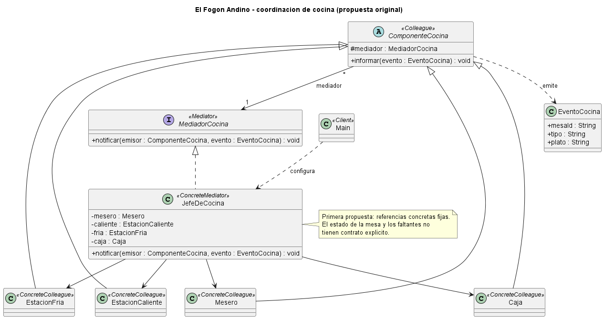
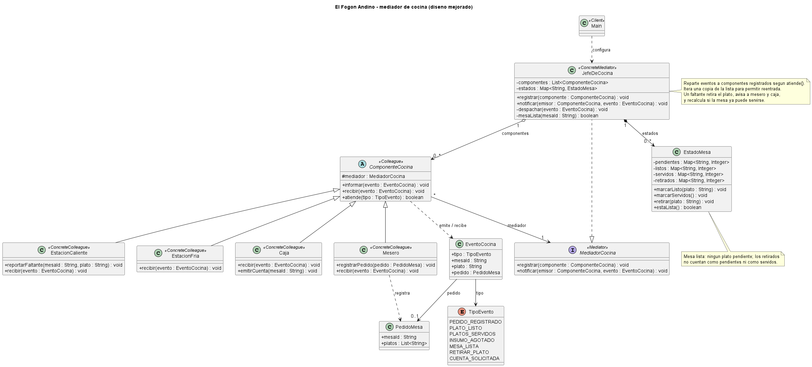

# Escenario 2: coordinación de cocina de El Fogón Andino

## Problema y patrón

Mesero, estaciones caliente y fría, y caja necesitan coordinar pedidos de varias mesas. Un faltante de insumo afecta la información al cliente, la cuenta y el momento de servir. **Mediator** concentra esas reglas en `JefeDeCocina`: cada componente informa al mediador y recibe sus avisos sin mantener referencias a los otros componentes.

## Punto 3: diagramas UML

| Versión | Fuente PlantUML | Imagen |
|---|---|---|
| Original | [mediatorE2.puml](uml/mediatorE2.puml) | [Diagrama original](uml/diagrama-clases-original.png) |
| Mejorada | [mediatorE2_mejorado.puml](uml/mediatorE2_mejorado.puml) | [Diagrama mejorado](uml/diagrama-clases-mejorado.png) |
| Secuencia | [mediatorE2_secuencia.puml](uml/mediatorE2_secuencia.puml) | Fuente editable; no se solicitó PNG |

La versión original ya usa un mediador, pero este conserva referencias fijas a cuatro clases concretas y no modela el estado de las mesas. La mejorada registra componentes por la abstracción `ComponenteCocina`, representa los eventos mediante `TipoEvento` y mantiene `EstadoMesa` por mesa. El mediador distingue platos pendientes, listos, servidos y retirados; retira un plato faltante y comprueba si los demás ya permiten servir. Al repartir eventos debe iterar una copia de la lista para tolerar reentrada.

El [diagrama de secuencia](uml/mediatorE2_secuencia.puml) muestra un faltante de fritada: `JefeDeCocina` retira el plato, avisa al mesero y a caja, y vuelve a evaluar la mesa. El mesero confirma después qué platos se sirvieron mediante un evento de reentrada. La estación fría no queda esperando el plato retirado.

## Punto 4: participantes

| Rol | Elemento UML | Responsabilidad |
|---|---|---|
| Mediator | `MediadorCocina` | Contrato para registrar componentes y recibir eventos. |
| ConcreteMediator | `JefeDeCocina` | Registra componentes, mantiene el estado de cada mesa y coordina los avisos. |
| Colleague | `ComponenteCocina` | Conoce solo a su mediador y define emisión y recepción de eventos. |
| ConcreteColleague | `Mesero`, `EstacionCaliente`, `EstacionFria`, `Caja` | Ejecutan su tarea y notifican cambios; no se referencian entre sí. |
| Client | `Main` | Configurará el mediador y registrará los componentes. |
| Datos de colaboración | `EventoCocina`, `TipoEvento`, `PedidoMesa`, `EstadoMesa` | Expresan eventos, pedido y progreso de la mesa; no son roles GoF. |

Cada `ComponenteCocina` tiene un mediador; `JefeDeCocina` agrega cero o más componentes registrados y posee los estados de mesa que crea. El registro debe ocurrir antes de procesar eventos. `atiende(tipo)` permite seleccionar destinatarios sin que el mediador dependa de clases concretas.

## Uso crítico de IA

**Prompt propuesto para revisar el diseño:** «POR COMPLETAR».

**Recomendación aceptada:** registrar componentes mediante una abstracción y modelar explícitamente `EstadoMesa`. Así el mediador puede incorporar nuevos participantes y razonar sobre platos pendientes y retirados.

**Recomendación rechazada:** permitir que la estación caliente avise directamente a mesero, caja y estación fría cuando falte un insumo. Eso reintroduciría las referencias cruzadas y repartiría la regla de coordinación entre colegas.

Estos textos son una propuesta de análisis para esta entrega; no se presentan como decisiones históricas previas del grupo.

## Implementación posterior

El Java sigue pendiente. Cuando se implemente, deberá respetar [la trazabilidad prevista](docs/trazabilidad-uml-codigo.md), probar el reparto de pedidos, la espera de todos los platos, el retiro por faltante, la actualización de caja y la reentrada; `CorrespondenciaUmlCodigoTest` deberá contrastar las clases con `mediatorE2_mejorado.puml`.
