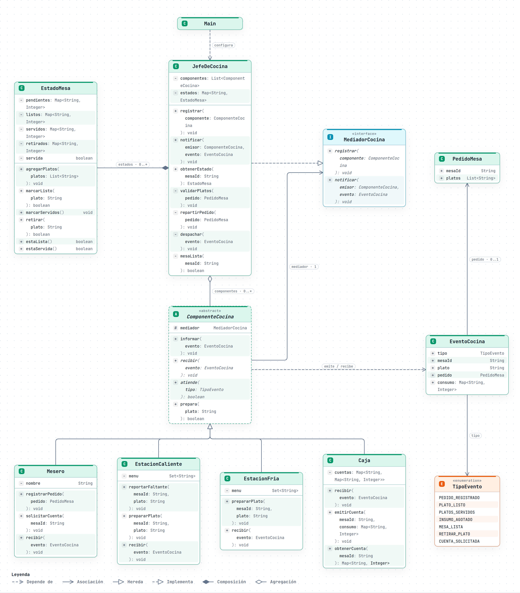

# Escenario 2: coordinación de cocina de El Fogón Andino (Mediator)

## 1. Escenario / Motivación

*El Fogón Andino* es un restaurante ficticio de comida ecuatoriana que en horas pico atiende varias mesas a la
vez. Cada pedido involucra a cuatro participantes que dependen unos de otros: el **mesero** (toma el pedido,
sirve y pide la cuenta), la **estación caliente** (platos fuertes y sopas), la **estación fría** (entradas,
ensaladas y postres) y la **caja** (registra lo consumido y emite la cuenta).

Cuando el mesero registra un pedido, cada ítem debe llegar a la estación que lo prepara; los platos de una mesa
se sirven juntos, así que el mesero solo se entera cuando todas las estaciones terminaron; y la caja debe saber
exactamente qué se sirvió. El caso más delicado es el **faltante de insumo**: si la estación caliente se queda
sin cerdo para la fritada, el mesero debe informar al cliente, la caja debe retirar la fritada de la cuenta y la
estación fría no debe quedarse esperándola. Además, el restaurante abrirá una parrilla y atenderá *delivery*. El
texto completo está en [`docs/enunciado-actividad-03.md`](../docs/enunciado-actividad-03.md).

## 2. Problema de diseño identificado

La solución directa es que cada participante tenga referencias a los demás y les avise por su cuenta. Presenta
cinco dificultades:

- **Acoplamiento de muchos a muchos:** con cuatro participantes ya hay una red de referencias cruzadas.
- **Coordinación dispersa y duplicada:** la regla "servir cuando todas las estaciones terminaron" se repite en
  cada estación.
- **Efectos en cadena difíciles de seguir:** un faltante obliga a avisar a varios y nadie tiene la visión completa.
- **Extensión costosa:** la parrilla o el *delivery* obligan a modificar a todos los participantes.
- **Participantes no reutilizables ni fáciles de probar:** una estación no existe sin las demás.

El problema de fondo es que la comunicación está repartida entre los propios participantes, cuando cada uno
debería hacer solo su trabajo y la coordinación vivir en un único lugar.

## 3. Justificación del patrón

Se eligió **Mediator** (encapsular en un objeto cómo interactúa un conjunto de objetos, evitando que se refieran
unos a otros). Encaja porque los participantes se comunican de forma compleja pero bien definida y esa
comunicación es lo que cambia cuando el restaurante crece. En una cocina real ese rol lo cumple el jefe de
cocina.

**Alternativas consideradas:**

- *Observer*: dejaría la regla de coordinación repartida entre los suscriptores.
- *Facade*: su comunicación es en un solo sentido; aquí los componentes también inician la comunicación.
- *Notificación directa entre estaciones*: reintroduce las referencias cruzadas que motivan el patrón.

## 4. Participantes del patrón

| Participante GoF | Elemento del dominio | Responsabilidad |
|---|---|---|
| Mediator | `MediadorCocina` | Contrato para registrar componentes y recibir eventos. |
| ConcreteMediator | `JefeDeCocina` | Registra componentes, reparte cada plato a la estación que lo prepara, lleva el estado de cada mesa y aplica las reglas de coordinación. |
| Colleague | `ComponenteCocina` | Conoce solo a su mediador; define `informar`, `recibir`, `atiende` y `prepara`. |
| ConcreteColleague | `Mesero`, `EstacionCaliente`, `EstacionFria`, `Caja` | Ejecutan su tarea y notifican cambios; no se referencian entre sí. |
| Client | `Main` | Arma el mediador y registra los componentes. |
| Datos de colaboración (no son roles GoF) | `EventoCocina`, `TipoEvento`, `PedidoMesa`, `EstadoMesa` | Expresan eventos, pedido y progreso de la mesa. |

**Colaboración:** cada componente informa un `EventoCocina` a `JefeDeCocina` y recibe solo los que `atiende`.
Un pedido se divide con `prepara(plato)`: cada estación recibe únicamente sus platos, y un plato que ninguna
estación prepara se rechaza. `EstadoMesa` cuenta platos pendientes, listos, servidos y retirados; cuando no hay
pendientes y hay algo listo, el mediador avisa `MESA_LISTA`, el mesero sirve y confirma `PLATOS_SERVIDOS`. Un
faltante retira el plato, avisa al mesero y a la caja y vuelve a evaluar la mesa. La cuenta se emite cuando el
mesero la solicita y contiene solo lo servido.

## 5. Diagrama de clases UML

| Versión | Fuente PlantUML | Imagen |
|---|---|---|
| Original | [mediatorE2.puml](uml/mediatorE2.puml) | [Diagrama original](uml/diagrama-clases-original.png) |
| Mejorada (implementada) | [mediatorE2_mejorado.puml](uml/mediatorE2_mejorado.puml) | [Diagrama mejorado](uml/diagrama-clases-mejorado.png) |
| Secuencia | [mediatorE2_secuencia.puml](uml/mediatorE2_secuencia.puml) | Fuente editable; no se solicitó PNG |

**Cómo leer el diagrama mejorado.** Las clases están agrupadas como en la tabla de participantes: *Roles del
patrón (GoF)* (Mediator, ConcreteMediator, Colleague, ConcreteColleague y Client, un color por rol según la
leyenda) y *Datos de colaboración*, que no son roles GoF.

Vista del mismo diseño generada con archify, con los miembros de cada tipo. Existe también una versión
interactiva con vistas guiadas, [`uml/diagrama-clases-mejorado.html`](uml/diagrama-clases-mejorado.html); GitHub
no ejecuta HTML, así que hay que descargarla y abrirla en el navegador. El `.puml` sigue siendo el contrato.

La versión original ya usa un mediador, pero este conserva referencias fijas a cuatro clases concretas, tipa los
eventos con texto y no modela el estado de las mesas. La mejorada registra componentes por la abstracción
`ComponenteCocina`, selecciona destinatarios con `atiende` y `prepara`, representa los eventos con `TipoEvento`
y mantiene `EstadoMesa` por mesa. Al repartir eventos itera una copia de la lista para tolerar la reentrada.

El [diagrama de secuencia](uml/mediatorE2_secuencia.puml) muestra un faltante de fritada: `JefeDeCocina` retira
el plato, avisa al mesero y a la caja y vuelve a evaluar la mesa; el mesero confirma lo servido mediante un
evento de reentrada y después pide la cuenta, que la caja emite solo con lo servido.

## 6. Código fuente

- Repositorio: <https://github.com/ups-master/pds-actividad-03-grupo-01/tree/main/escenario-2-mediator>
- Manual de uso (estructura, pruebas, ejecución, cómo agregar un colega): [`codigo/README.md`](codigo/README.md)
- Trazabilidad UML-código: [`docs/trazabilidad-uml-codigo.md`](docs/trazabilidad-uml-codigo.md)
- Pruebas: 76 (45 de correspondencia UML-código y 31 funcionales), todas aprobadas.

## 7. Validación de la solución

**Qué problema resolvió.** Ningún componente conoce a otro: todos se comunican con `JefeDeCocina`. La regla
"servir cuando todas las estaciones terminaron" vive una sola vez, un faltante es un único aviso al mediador y
la cuenta refleja exactamente lo servido (la fritada retirada no se cobra).

**Qué mejoró frente a la solución directa.**

- Extensión: una estación nueva (parrilla) se crea y se registra sin modificar a los demás ni al mediador; una
  prueba registra una parrilla y comprueba que no recibe platos ajenos.
- Reglas en un solo lugar: reparto por estación, mesa lista, faltante y cuenta.
- Pruebas: los colegas se prueban con un mediador real y colegas de registro, sin construir toda la cocina.
- Aislamiento verificable: una prueba por reflexión comprueba que ningún colega tiene campos de otro colega.

**Costos y complejidad adicional.**

- El mediador concentra la coordinación y puede crecer demasiado (un `switch` por tipo de evento). Para
  contenerlo, `JefeDeCocina` solo coordina y cada componente hace su trabajo.
- El flujo es indirecto: seguir un evento exige leer el mediador, no los componentes.
- La reentrada exige cuidado (se itera una copia de la lista).
- El mediador y el estado de las mesas no son seguros para uso concurrente.
- Se agregan clases de soporte (`EventoCocina`, `TipoEvento`, `PedidoMesa`, `EstadoMesa`).

**Cuándo no se recomienda.** Con pocos participantes y una interacción simple, o cuando la comunicación es
solo en un sentido (*Observer* o *Facade* bastan). Tampoco si el mediador acabaría concentrando lógica de
dominio compleja: habría que dividirlo. En un entorno concurrente, antes habría que sincronizarlo.

## 8. Uso crítico de IA

**Prompt principal:**

Actúa como un arquitecto de software experto en patrones de diseño GoF, UML y PlantUML. Adjunto el archivo PlantUML de mi solución inicial al Escenario 2 (coordinación de la cocina de El Fogón Andino con Mediator). Participan mesero, estación caliente, estación fría y caja. Requisitos: cada ítem del pedido llega a la estación que lo prepara; los platos de una mesa se sirven juntos; si falta un insumo, el mesero informa al cliente, la caja retira el plato y la otra estación no se queda esperando; la caja emite la cuenta con lo que se sirvió; el restaurante sumará una estación de parrilla y delivery. Valida si el diagrama aplica correctamente el patrón y cumple esos requisitos:

1. Verifica que estén todos los roles del patrón (Mediator, ConcreteMediator, Colleague, ConcreteColleague y Client) y que cada clase cumpla su responsabilidad.
2. Revisa que los colegas conozcan solo al mediador y que ningún colega dependa de otro.
3. Evalúa si el mediador depende de abstracciones o de clases concretas, y si se puede agregar un participante nuevo sin modificarlo.
4. Comprueba que los eventos y el estado que necesita el mediador para coordinar (qué platos de cada mesa están pendientes, listos, servidos o retirados, y si la mesa ya se sirvió) estén modelados de forma explícita, y si se considera el caso de un colega que responde mientras el mediador reparte un evento.
5. Revisa que relaciones, multiplicidades, visibilidades y dependencias sean correctas y suficientes para implementar el diseño.

Condiciones: no cambies el patrón ni los nombres de las clases existentes; justifica cada mejora con un problema concreto del diagrama; no generes código Java. Entrega una lista de problemas encontrados, las mejoras propuestas con su justificación, el archivo PlantUML completo con las mejoras aplicadas y, por separado, al menos una alternativa de diseño con sus ventajas y desventajas, sin aplicarla.

**Recomendación aceptada (con justificación):** se aceptó el conjunto de mejoras que la IA propuso sobre el diagrama inicial y que forman el diagrama mejorado (`mediatorE2_mejorado.puml`), del que se deriva el código:

1. Registrar los participantes mediante la abstracción `ComponenteCocina` (`registrar` en el mediador, `recibir` y `atiende(tipo)` en el colega) en lugar de un atributo por cada colega concreto.
2. Repartir cada pedido por estación con `prepara(plato)`: cada estación declara su `menu` y recibe solo sus platos.
3. Tipar los eventos con `TipoEvento` y agregar `PedidoMesa` y el consumo servido a `EventoCocina`.
4. Modelar `EstadoMesa` por mesa (pendientes, listos, servidos, retirados y si ya se sirvió) para decidir cuándo servir, retirar un plato faltante y no servir dos veces.
5. Hacer que la caja emita la cuenta con lo servido cuando el mesero la solicita (`solicitarCuenta`, `emitirCuenta(mesaId, consumo)`).
6. Repartir los eventos sobre una copia de la lista de componentes para tolerar la reentrada.

La aceptamos porque en el diseño inicial `JefeDeCocina` tenía un atributo por cada colega, así que sumar la parrilla o el *delivery* obligaba a modificar el mediador. `EstadoMesa` le permite retirar un plato faltante y decidir si la mesa ya puede servirse sin que la estación fría espere. El enunciado pide que cada ítem llegue a su estación y que la caja sepa qué se sirvió, y el diseño inicial no cubría ninguna de las dos cosas. El enum evita errores por textos mal escritos y la copia permite que el mesero responda durante el reparto sin alterar la iteración.

**Recomendación modificada o rechazada (con justificación):** que la estación caliente, al quedarse sin un insumo, avise directamente al mesero, a la caja y a la estación fría para que la reacción sea inmediata.

La rechazamos porque reintroduce las referencias cruzadas entre colegas que motivaron el patrón y reparte la regla de coordinación entre varias clases. Cada participante nuevo, como la parrilla o el *delivery*, obligaría a modificar a los demás. Con Mediator, la estación solo informa el faltante y `JefeDeCocina` concentra la coordinación.
